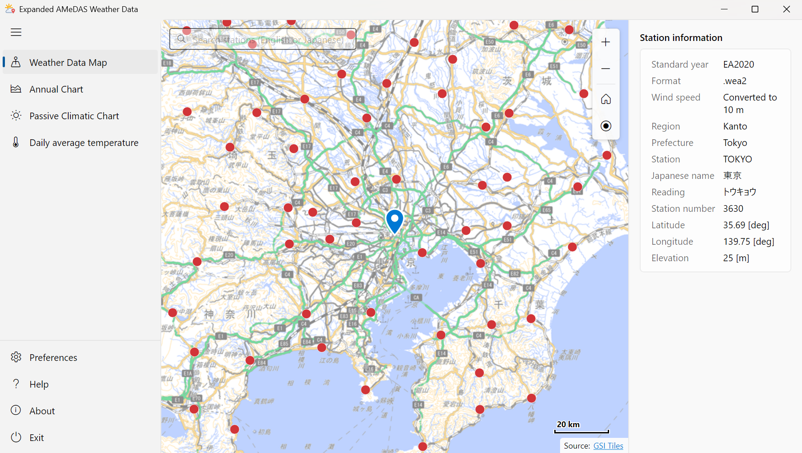
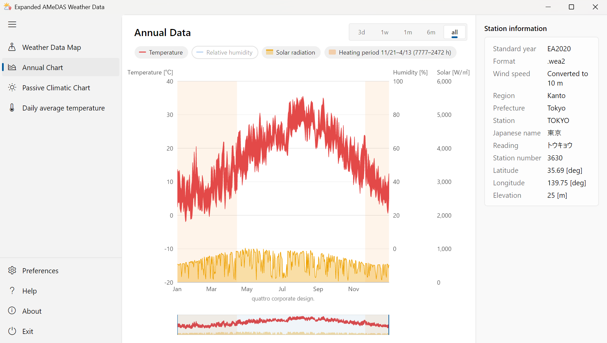
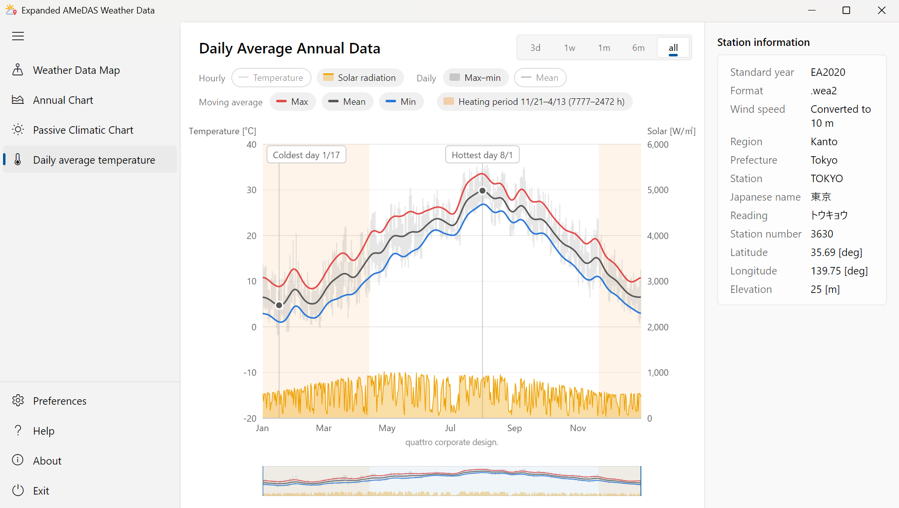
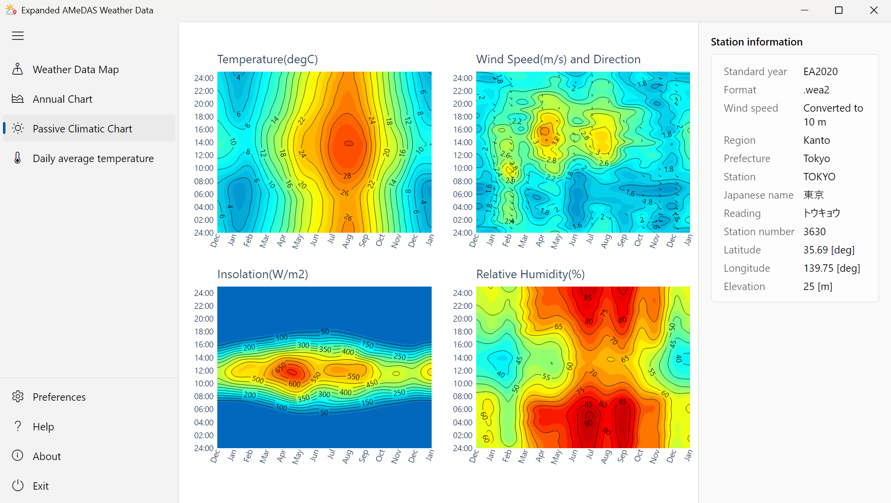
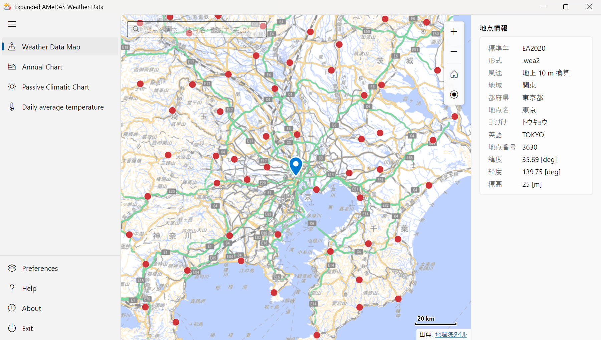
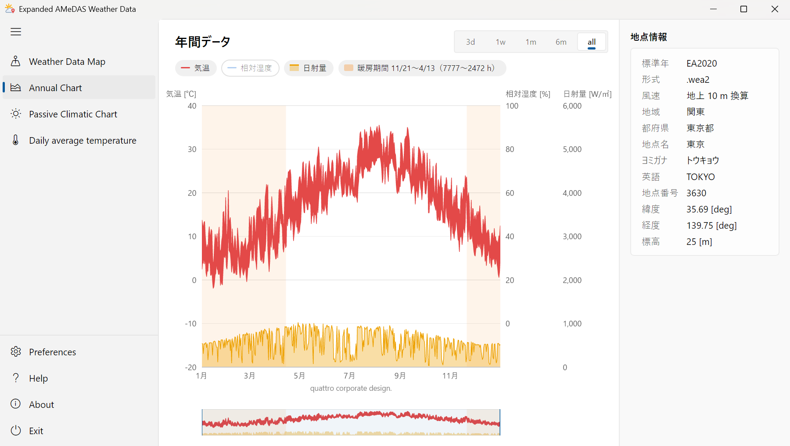
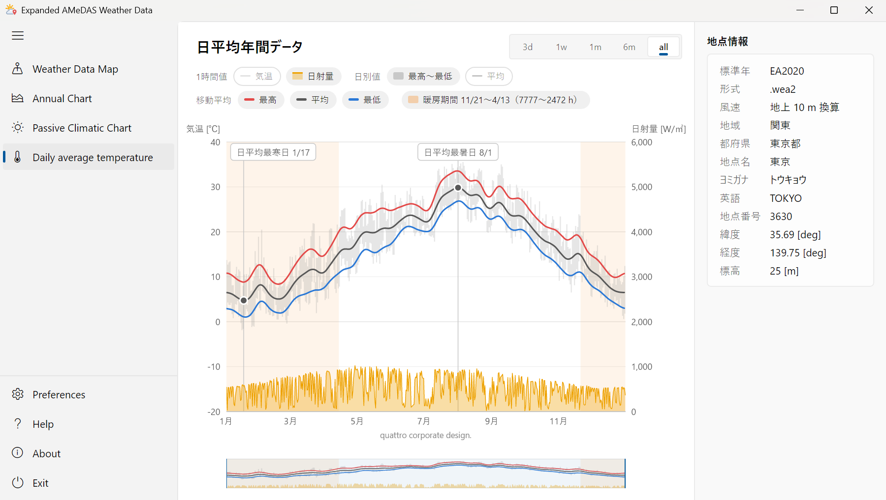

# ExtAMeDAS

Expanded AMeDAS Weather Data plug-in for TRNSYS Type99

[English](#english) | [日本語](#japanese)

## English

ExtAMeDAS is a plug-in for the Type99-AMeDAS component of TRNSYS. Select a station of the Expanded AMeDAS Weather Data (EA weather data) on a map, and the plug-in creates a weather data file (.99) that TRNSYS Type99 can read and sets it in the component. Charts of the annual data, the passive climatic chart and the daily average annual data show the climate of the selected station.

### Download

Download the installer and the manual from [Releases](https://github.com/TRNSYSJP/ExtAMeDAS/releases/latest).

| File | Contents |
|---|---|
| `ExtAMeDAS-Setup-1.0.1.<build>.exe` | Installer (English / Japanese) |
| `ExtAMeDAS-en-US.html` | Manual (English) |
| `ExtAMeDAS-ja-JP.html` | Manual (Japanese) |

The manual is also installed with the plug-in, and opens with Help (F1 key) in the plug-in menu.

### Features

- **EA weather data in .wea and .wea2 formats**: the 1995, 2000, 2010 and 2020 standard years and the 2086 future edition. The format is detected from the file contents, and a file of a different edition is not accepted.
- **Station selection on a map**: GSI Tiles (pale map). Search by English name, Japanese name, kana reading or station number.
- **Charts**: the annual data, the passive climatic chart and the daily average annual data (moving averages, coldest and hottest days). Switch the range (3 days to 1 year), show or hide data with the legend, and save the image as PNG or SVG, or copy it.
- **Heating period**: the period in which the moving average of the daily mean temperature is 15 °C or lower is shaded. The legend shows the dates and the simulation times [h] (e.g. "11/21–4/13 (7777–2472 h)").
- **Type99 file (.99)**: written to `Weather\JP-AMeDAS` in the TRNSYS 18 folder and set in the component. The file name contains the standard year and the format (e.g. `EA2020-wea2_3630_TOKYO.99`), and the component title becomes the English name of the station (e.g. TOKYO).
- **Two-year .99 option**: with a time step shorter than 1 hour, Type99 can stop at hour 8,760 in a simulation that goes past the end of the year. Select 2 years (17,520 h) in Preferences to avoid this.
- **No .NET runtime required.** The user interface, the manual and the installer are shown in English, or in Japanese if the Windows display language is Japanese.

### Supported weather data

| Standard year | Format | Statistics period | Stations |
|---|---|---|---|
| EA1995 (1995 edition) | .wea / .wea2 | 1981–1995 | 842 |
| EA2000 (2000 edition) | .wea / .wea2 | 1991–2000 | 842 |
| EA2010 (2010 edition) | .wea / .wea2 | 2001–2010 | 836 |
| EA2020 (2020 edition) | .wea2 | 2011–2020 | 841 |
| EA2086 (2086 future edition) | .wea2 | 2077–2095 | 841 |

The station information (station name, latitude, longitude, elevation, kana reading) is read from the station information file on the EA weather data media. Keep it in the same folder as the standard year file (`.wea`: `CITYINFO.DAT` / `StnInfo.dat` / `StnInfo0110.dat`, `.wea2`: `StnInfo_<file name>.dat`).

### Requirements

- Windows 10 / Windows 11 (64-bit)
- TRNSYS 18 (Simulation Studio)
- A standard year file of the EA weather data and the station information file on the same media. **The weather data is not included in this plug-in. Please purchase it separately.**
- An Internet connection to display the map (the map is kept on the PC for 14 days)

### Installation

1. Run `ExtAMeDAS-Setup-1.0.1.<build>.exe` (administrator privileges are required) and select the TRNSYS 18 folder (usually `C:\TRNSYS18`).
2. The Type99-AMeDAS component is added to **Quattro > Weather Data Reading and Processing > Standard Format with Map > Japan** in the Direct Access Toolbar of Simulation Studio.
3. Open the component, click the magic stick button, and set the standard year file in **Preferences**.

- The installer is not code-signed, so Windows SmartScreen may show a warning. Click "More info" and then "Run anyway".
- Version 0.1.7 or earlier is uninstalled automatically, and its settings are carried over.

### License terms of the EA weather data

Use the EA weather data in accordance with the license terms supplied with the product. For example, when you publish results obtained with the EA weather data, state that the EA weather data was used. The .99 files written by this plug-in are data obtained by processing the EA weather data. Do not give them to third parties.

### Screenshots

Annual data (the orange background is the heating period)

Daily average annual data

Passive climatic chart

### Notes

- The map is GSI Tiles of the Geospatial Information Authority of Japan. The charts in the screenshots use the EA weather data (Meteorological Data System Co., Ltd.).
- The licenses and attributions of the maps, data, icons and libraries used by the plug-in are shown in **About > License information**, and in `THIRD-PARTY-NOTICES.txt` in the plug-in folder.

Copyright © 2026 quattro corporate design. All rights reserved.

---

## 日本語

TRNSYS の Type99-AMeDAS コンポーネントのプラグインです。拡張アメダス気象データ（拡張AMeDAS、EA気象データ）の地点を地図で選ぶと、TRNSYS の Type99 で読める気象データ（.99）を作り、コンポーネントに設定します。選んだ地点の気候は、年間データ、パッシブ気候図、日平均年間データ（移動平均チャート）のチャートで確認できます。

### ダウンロード

インストーラーとマニュアルは [Releases](https://github.com/TRNSYSJP/ExtAMeDAS/releases/latest) からダウンロードしてください。

| ファイル | 内容 |
|---|---|
| `ExtAMeDAS-Setup-1.0.1.<ビルド番号>.exe` | インストーラー（日本語・英語） |
| `ExtAMeDAS-ja-JP.html` | マニュアル（日本語） |
| `ExtAMeDAS-en-US.html` | マニュアル（英語） |

マニュアルはプラグインと一緒にインストールされ、プラグインのメニューの Help（F1 キー）で開けます。

### 主な機能

- **.wea と .wea2 に対応**：1995年版・2000年版・2010年版・2020年版の標準年と、2086年将来版。形式はファイルの中身で判定し、年版の違うファイルは設定しません。
- **地図で地点を選択**：国土地理院の地理院タイル（淡色地図）。地点名・ヨミガナ（ひらがなでも可）・英語表記・地点番号で検索できます。
- **チャート**：年間データ、パッシブ気候図、日平均年間データ（移動平均、日平均最寒日・最暑日）。表示期間の切り替え（3日～1年）、凡例による表示・非表示の切り替え、画像の保存（PNG / SVG）・コピーができます。
- **暖房期間の表示**：日平均気温の移動平均が 15 ℃以下の期間を背景に塗ります。凡例に期間と TRNSYS のシミュレーションの時刻 [h] を表示します（例: 「暖房期間 11/21～4/13（7777～2472 h）」）。
- **Type99 の気象データ（.99）**：TRNSYS 18 のフォルダの `Weather\JP-AMeDAS` に書き出し、コンポーネントに設定します。ファイル名には標準年と形式が入り（例: `EA2020-wea2_3630_TOKYO.99`）、コンポーネントの名前は地点の英語表記（例: TOKYO）になります。
- **2 年分の .99**：タイムステップが 1 時間より短く、年をまたいで計算すると、Type99 が 8,760 時で止まることがあります。基本設定で 2 years (17,520 h) を選ぶと避けられます。
- **.NET のインストールは不要です。** 画面・マニュアル・インストーラーは、Windows の表示言語が日本語なら日本語、それ以外は英語で表示します。

### 対応している気象データ

| 標準年 | 形式 | 統計期間 | 地点数 |
|---|---|---|---|
| EA1995（1995年版） | .wea / .wea2 | 1981〜1995年 | 842 |
| EA2000（2000年版） | .wea / .wea2 | 1991〜2000年 | 842 |
| EA2010（2010年版） | .wea / .wea2 | 2001〜2010年 | 836 |
| EA2020（2020年版） | .wea2 | 2011〜2020年 | 841 |
| EA2086（2086年将来版） | .wea2 | 2077〜2095年 | 841 |

地点の情報（地点名、緯度・経度、標高、ヨミガナ）は、拡張アメダスの媒体にある地点情報のファイルから読みます。標準年のファイルと同じフォルダに置いてください（.wea: `CITYINFO.DAT` / `StnInfo.dat` / `StnInfo0110.dat`、.wea2: `StnInfo_<ファイル名>.dat`）。

### 動作環境

- Windows 10 / Windows 11（64bit）
- TRNSYS 18（Simulation Studio）
- 拡張アメダス気象データの標準年のファイルと、同じ媒体にある地点情報のファイル。**気象データはプラグインに含まれていません。別途ご購入ください。**
- 地図の表示にはインターネット接続が必要です（表示した地図は 14 日間 PC に保存します）

### インストール

1. `ExtAMeDAS-Setup-1.0.1.<ビルド番号>.exe` を実行し（管理者の権限が必要です）、インストール先に TRNSYS 18 のフォルダ（通常は `C:\TRNSYS18`）を選びます。
2. Simulation Studio の Direct Access Toolbar の **Quattro → Weather Data Reading and Processing → Standard Format with Map → Japan** に、Type99-AMeDAS のコンポーネントが追加されます。
3. コンポーネントを開き、マジックスティックのボタンでプラグインを起動して、**Preferences**（基本設定）で標準年のファイルを設定します。

- インストーラーにはコード署名をしていないため、Windows SmartScreen の警告が表示されることがあります。「詳細情報」→「実行」をクリックしてください。
- 0.1.7 以前がインストールされている場合は、自動でアンインストールし、設定を引き継ぎます。

### 拡張アメダス気象データの使用許諾について

拡張アメダス気象データは、製品に付属している使用許諾に従ってご使用ください。たとえば、拡張アメダス気象データを使用して得られた成果物を公表する場合は、拡張アメダス気象データを使用した旨を明記します。このプラグインが書き出す .99 は、拡張アメダス気象データを加工したデータです。第三者に渡さないでください。

### 画面

年間データ（背景のオレンジは暖房期間）

日平均年間データ

パッシブ気候図

### 関連する記事（ブログ）

- [TRNSYS拡張アメダスの新しいプラグイン](https://www.kankyoukei.com/2021/12/trnsys-type99-amedas-plugin.html)（2021年12月）
- [拡張アメダスから日平均気温を計算](https://www.kankyoukei.com/2021/11/daily-mean-temperature.html)
- [拡張アメダス気象データで暖房期間を計算](https://www.kankyoukei.com/2025/11/plot-heating-period.html)

### 注記

- 地図は国土地理院の地理院タイル（淡色地図）です。画面のチャートは、拡張アメダス気象データ（株式会社気象データシステム）を使用しています。
- プラグインが使っている地図・データ・アイコン・ライブラリのライセンスと出典は、バージョン情報の「ライセンス情報」と、プラグインのフォルダの `THIRD-PARTY-NOTICES.txt` で確認できます。

Copyright © 2026 quattro corporate design. All rights reserved.
